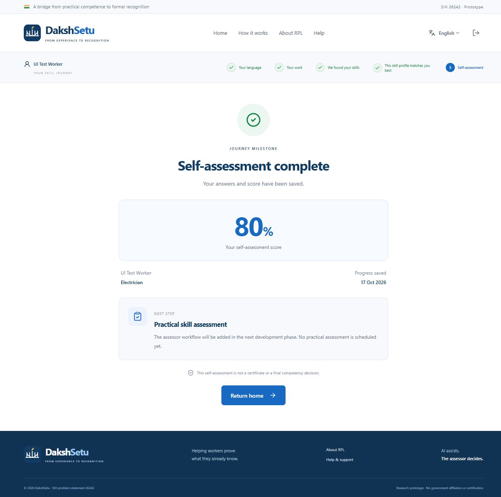

# Phase 1–5 verification

Historical report from the Phase 1–5 delivery, verified on 17 October 2026 (Asia/Calcutta). The current implementation continues through Phase 14; see [the current verification report](TESTING-PHASES-11-14.md). Screenshots below show the earlier design.

## Results

| Check                         | Observed result                                                                                                                   |
| ----------------------------- | --------------------------------------------------------------------------------------------------------------------------------- |
| `npm test`                    | **14 passed, 0 failed, 0 skipped** against real MongoDB 8.0.                                                                      |
| `npm run build`               | Server TypeScript compilation and React/Vite production build passed.                                                             |
| `npm run test:live -w server` | Real Gemini request passed, followed by stored skill confirmation, qualification matching, and self-assessment persistence.       |
| Compiled server smoke test    | Local production-mode API and React deep link both returned HTTP 200; MongoDB connected. Temporary port 4001 process was stopped. |
| Client bundle check           | No Gemini key variable, Gemini service endpoint, or `correctAnswer` property in the built frontend.                               |

The first sandboxed test run could not access localhost. Running the local services and integration tests with the environment's required network permission resolved that restriction. Validation tests then identified an ESM/CommonJS split between shared code and the server; declaring the root package as an ES module fixed the incorrect error status. All final checks passed after that fix.

## Integration coverage

1. Real MongoDB connectivity and repeatable seed data.
2. Registration, bcrypt password hashes, worker profile creation, session restoration, normalized email login.
3. Duplicate emails, invalid inputs, bad credentials, forged sessions, privileged registration rejection, worker role protection.
4. Language preference, trade, experience, and description persistence.
5. Explicit AI unavailability and working manual skill confirmation.
6. Gemini request/response transport contract and persisted extracted skills.
7. Invalid JSON, invalid AI trade output, and provider rate-limit failures.
8. Deterministic demo qualification matching, weights, stored match, and demo labels.
9. Invalidating previous skills and qualification after the experience changes.
10. Question retrieval without answer keys, 80% scoring, stored answers/result, repeat submission returning the same assessment.
11. Prerequisites, duplicate/unknown question IDs, and invalid answer indexes.
12. Later-phase endpoints remain unavailable.
13. Worker data isolation and persistence across construction of a fresh API instance.
14. Rejection of client-supplied scores and server-calculated 0% / 100% boundaries.

Tests use separate generated `dakshsetu_test_<uuid>` databases; cleanup verifies the exact test database name before dropping it. The regular development database is preserved.

## Live AI result

Synthetic description: an electrician with eight years of experience in house wiring, switches, fans, MCBs, and fault repair.

Gemini returned **Residential Wiring, MCB Installation, Switch Installation, and Fault Diagnosis**. It did not invent Safety Practices from the trade alone. These skills were persisted, confirmed, and mapped to the demo qualification at **75%**. The live test then submitted all five correct answers and verified a stored **100%** result. The API key stayed on the server and was not printed.

## Browser walkthrough

The desktop walkthrough at 1280 × 900 verified:

- Landing navigation and the language screen.
- Hindi selection and translated controls.
- Demo worker sign-in, followed by sign-out.
- Registration of a separate synthetic **UI Test Worker**, preserving the demo worker's assessment state.
- Electrician selection; unsupported trades disabled as Coming soon.
- 5+ years selection and typed experience.
- Live Gemini extraction through the actual frontend/API.
- Removing Fault Diagnosis, adding Fan Installation, and saving the confirmed skills.
- An updated **65%** qualification match based on the three canonical matched skills.
- Five questions, answer review, and submission of four correct answers for **80%**.
- Reloading the result page and recovering the same stored score.
- Recovery using Try again after a temporary development-server restart.
- A direct `/worker/quiz` link on the untouched demo account redirects back to trade selection.

At 390 × 844, the result page fit without horizontal scrolling (375 CSS pixels of content and viewport after the scrollbar). Marathi selection updated headings, trade, date, and next-step copy; the document language changed to `mr`. The viewport override was reset after testing.

## Verification limits

Actual microphone capture and audible speech synthesis were not exercised. Both depend on browser support, a device, permissions, and available speech services. Text input and the manual skills path remain available. The frontend's manual control was reviewed; the backend's AI-unavailable/manual-confirmation flow was exercised in the integration suite.

No Atlas network connection was used; MongoDB persistence was verified on the installed local server. Cloudinary, assessor workflows, practical assessment, passports, offline support, and deployment were deliberately excluded.

## Community Wisdom

### 🌐 Community Wisdom: [Request validation with Zod in Express](https://dev.to/zsevic/request-validation-with-zod-in-express-4gj0)

> **Source**: [zsevic](https://dev.to/zsevic)
> **Tags**: `zod`, `express`, `validation`, `node`
>
> The article recommends validating requests at the HTTP boundary and mapping schema failures to consistent 400 responses. This informed the shared validation schemas and negative API tests. The retrieved discussion had no comments; this is one supporting source, not evidence of a community-wide consensus. The app uses Zod 3 syntax, matching its pinned major version.
>
> 🔗 [Read Full Discussion](https://dev.to/zsevic/request-validation-with-zod-in-express-4gj0)
